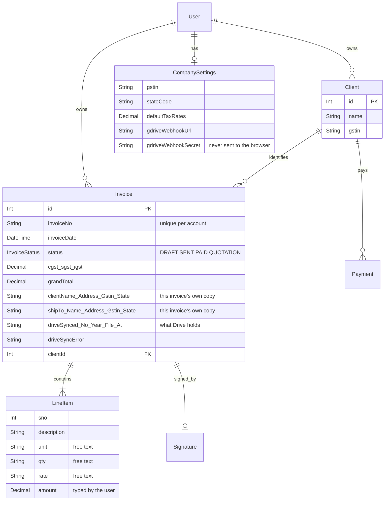

# RKE GST Invoice Generator — Project Architecture

Welcome to the **RKE GST Invoice Generator** codebase, a premium, cloud-hosted application designed for **M/S Radha Kishan Enterprises** (a heavy engineering equipment rental business). This application is bootstrapped using **Next.js 16 (App Router)** and **React 19**, incorporating modern web design best practices (sleek layouts, system dark/light modes, premium typography, and dynamic micro-interactions).

---

## 🛠️ Technology Stack & Architecture

- **Core Framework**: [Next.js 16](https://nextjs.org) (App Router, Server Actions) and [React 19](https://react.dev).
- **Styling**: [Tailwind CSS v4](https://tailwindcss.com/) with custom tokens, and shadcn/ui primitives on `@base-ui/react`.
- **Database ORM**: [Prisma ORM v6](https://www.prisma.io/) with [PostgreSQL](https://www.postgresql.org/) hosted on **Vercel Postgres**.
- **State Management**: [Zustand](https://github.com/pmndrs/zustand) for the client-side invoice builder store.
- **Validation**: [Zod](https://zod.dev) schemas for every server action payload.
- **Hosting**: **Vercel**. (`Dockerfile` and `cloudbuild.yaml` are from an earlier Cloud Run setup and are not used.)
- **Integrations**:
  - `@react-pdf/renderer` — the one invoice PDF template, rendered in the browser (live preview, "Original / Duplicate / Triplicate" downloads) and on the server (dashboard downloads, ZIP, Google Drive).
  - `qrcode` — the "Scan for Details" QR printed on every invoice PDF.
  - `react-signature-canvas` — the drawn-signature pad.
  - `xlsx` & `jszip` — spreadsheet and ZIP exports.
  - Gemini (with OpenAI / Mistral fallbacks) — invoice scanning, called from the server only.
  - A user-deployed **Google Apps Script** — files PDFs, a ledger sheet and database backups in the owner's Google Drive.

---

## 📂 Project Directory Structure

```text
rke-invoice/
├── app/                          # Next.js App Router
│   ├── actions/                  # Server Actions — all mutations live here
│   │   ├── account.ts            # Change password
│   │   ├── auth.ts               # Sign in / sign out / invite-only sign up
│   │   ├── gdrive.ts             # Save/test the Drive address, sync one or all, get the script
│   │   ├── invoices.ts           # Create, update, delete invoices
│   │   ├── ledger.ts             # Client statements and payments
│   │   ├── ocr.ts                # AI invoice scan
│   │   └── settings.ts           # Company settings
│   ├── api/
│   │   ├── export/invoices/      # XLSX/ZIP data for the dashboard (login required)
│   │   └── invoices/[id]/download/  # The server-made PDF of one invoice (login required)
│   ├── dashboard/                # Invoice list and the month's total
│   ├── invoices/{new,[id]}/      # Invoice editor
│   ├── ledger/                   # Client ledger and payments
│   ├── login/, signup/           # Sign-in; sign-up (closed unless an invite code is set)
│   └── settings/                 # Company, bank, tax defaults, Drive sync, change password
├── components/                   # Domain components
│   ├── dashboard/                # Invoice table, selection, ZIP/XLSX actions
│   ├── invoice/                  # Editor, form, line-item table, saved-client picker, live preview, store
│   ├── ledger/, layout/, signature/, settings/, export/
│   ├── pdf/                      # InvoicePDF.tsx (the template), fonts.ts, PdfActions.tsx
│   └── ui/                       # Shared primitives (incl. decimal-input)
├── lib/
│   ├── calculations.ts           # GST, whole-paise money, amounts in words (the only place figures are computed)
│   ├── clientIdentity.ts         # Pure: what makes a client "the same", and the per-invoice client copy
│   ├── clients.ts                # (server) find or create the client record; list billed clients
│   ├── serialize.ts              # (server) saved invoice → form data / company preview (the one mapper)
│   ├── generatePdfServer.ts      # (server) invoice → PDF buffer
│   ├── pdfFonts.ts               # (server) where the PDF font is read from
│   ├── qr.ts                     # QR text and PNG
│   ├── export.ts                 # XLSX sheet builders, safe sheet names
│   ├── gdrive.ts, gdriveCore.ts, gdriveScript.ts   # Drive sync, its pure rules, and the Apps Script text
│   ├── ocr.ts                    # AI scan readers, limits and result validation
│   ├── auth.ts, session.ts, crypto.ts, authorization.ts   # Sessions and password hashing
│   ├── states.ts                 # Indian states and state-code normalisation
│   ├── invoiceStatus.ts          # Which statuses count as billed
│   ├── bootstrap.ts, defaults.ts, db.ts, utils.ts, resolveLogoUrl.ts
├── prisma/
│   ├── schema.prisma             # PostgreSQL schema
│   └── seed.ts                   # Creates the first login from SEED_* environment variables
├── public/fonts/                 # Arimo-Regular.ttf, Arimo-Italic.ttf (PDF font, also served to the browser)
├── tests/                        # node:test suites, run with `npm test`
└── next.config.ts                # Standalone output, server-action body limit, font file tracing
```

---

## 🗄️ Database Schema & Models

The schema is in [schema.prisma](prisma/schema.prisma). Every record belongs to a `User` (the account) and is only ever read or changed through that account.



### Key Schema Characteristics
1. **`Invoice`** carries its own copy of the bill-to and ship-to details, written on every save, so an invoice already issued never changes when a client is picked, edited or reused. Invoices saved before this existed have the copy empty and fall back to the linked `Client` (`billToOf`). `@@unique([userId, invoiceNo])` makes numbers unique per account.
2. **`Client`** only identifies who has been billed (matched by name + GSTIN). Nothing saved on an invoice edits a client row. The invoice screen's "Saved client" list shows clients that have an invoice or payment.
3. **`LineItem`** `unit`, `qty` and `rate` are free text printed exactly as typed; `amount` is typed by the user and is the only figure used in totals. `@@unique([invoiceId, sno])` keeps line order consistent.
4. **`CompanySettings`** holds the supplier's details, default GST rates, bank/UPI details, terms and the Google Drive address and private key.
5. **`Invoice.pdfData` / `pdfName`** are legacy columns: PDFs are now made on demand, and the Prisma client omits `pdfData` from every query (`lib/db.ts`).

---

## 🧮 Core Business Logic

### 1. Line Amounts Are Typed, Not Calculated (`lib/calculations.ts`)
Unit, Qty and Rate are descriptive text (for example `26 Days`, `5,000 per day`) and take part in no formula. The user types each line's Amount; `parseAmount()` reads it (commas and a ₹ sign are accepted) and the totals add those amounts up and apply GST. Meter Start / Meter End are printed as notes and do not change Qty.

### 2. GST and Money (`lib/calculations.ts`)
- Money is held in whole **paise**: amounts are read as integers, tax is computed with BigInt and rounded half-up on the decimal text (so `26.50 × 9%` is `2.39`, not `2.38`).
- `resolveTaxMode(company, client)` is the single decision: **intra-state** (CGST + SGST) when the supplier's and the client's state codes match, otherwise **inter-state** (IGST). State codes are normalised first, so `9` and `09` are the same state. The editor, the PDF, the spreadsheets and the server all call it.
- The amount in words uses the Indian system (Lakhs and Crores): `1,25,500.50` → *Rupees One Lakh Twenty Five Thousand Five Hundred and Paise Fifty Only*.

### 3. Manual Invoice Numbers (`app/actions/invoices.ts`)
Invoice numbers are never generated or pre-filled. The field starts blank, the number shows in the live PDF as it is typed, and on save the server rejects a blank number or one the account already uses, before anything is written. A second account may use the same number.

### 4. One PDF Pipeline
`components/pdf/InvoicePDF.tsx` is the only template. A saved invoice is turned into its data by `toInvoiceFormData` (`lib/serialize.ts`); the browser preview uses the editor's state, and everything else (dashboard download, ZIP, Google Drive) calls `generateInvoicePdfBuffer` (`lib/generatePdfServer.ts`). The QR text comes from `buildInvoiceQrText` (`lib/qr.ts`).
**Fonts** are Arimo, registered by `components/pdf/fonts.ts` (browser, from `/fonts/…`) and `lib/pdfFonts.ts` (server, from `public/fonts`, falling back to the published copies). Each font file is registered once; registering the same file again for bold makes react-pdf keep two copies under one name and later PDFs can lose the first character of bold text (`tests/pdf-fonts.test.ts`).

### 5. Google Drive Sync (`lib/gdrive.ts`)
After a save, `after()` runs the sync once the reply has gone out: a fresh PDF is uploaded, the ledger sheet row is written, and anything an earlier sync left under another number or name is removed. Every request carries the account's private key and goes only to an address that starts with `https://script.google.com/macros/`. Each step's result is checked; the outcome (file, number, year, time, or the error) is stored on the invoice and shown in the editor. Deleting an invoice removes its recorded file and row and refreshes the backup. **Sync All** works through invoices that were never synced, failed, or were edited since, a few at a time within the host's time limit.

### 6. Access and Sign-in
Login cookies are signed with `SESSION_SECRET` (7-day sessions). Passwords are stored as salted PBKDF2 hashes (`lib/crypto.ts`); a password is changed in Settings (10+ characters, as for sign-up and the seed script). Sign-up is closed unless `SIGNUP_INVITE_CODE` is set. The first login is created with `npx prisma db seed` from `SEED_*` variables — no credentials are kept in the repository.

### 7. AI Scan (`lib/ocr.ts`, `app/actions/ocr.ts`)
The browser shrinks a picture (PDFs must be under 3 MB), the server action checks the type and size, and the reader's answer is validated field by field before it fills the form. Only Gemini reads PDFs; OpenAI and Mistral are picture-only fallbacks. Models are set by `GEMINI_MODEL`, `OPENAI_MODEL`, `MISTRAL_MODEL`, and the user always reviews the result before saving.

---

## 🎨 User Interface & Page Flows

1. **Dashboard (`/dashboard`)**: a *Total Invoiced* card for the current month (quotations excluded) and a searchable table of every invoice with row actions (PDF, XLSX, delete) and bulk ZIP / XLSX export.
2. **Invoice Editor (`/invoices/new`, `/invoices/[id]`)**: a form (Core Details, Billed & Shipped Consignee with the saved-client picker, Logistics, Line Items) beside a live PDF preview on large screens; a four-step wizard on phones. The editor shows when the invoice was last synced to Drive, or why the last sync failed.
3. **Ledger (`/ledger`)**: debits (invoices, quotations excluded), credits (payments) and the running balance, per client or for all.
4. **Settings (`/settings`)**: company and bank details, default tax rates, Google Drive sync (address, script to copy, Sync All), and Change password.

---

## 💡 Developer Guidelines & Workflows

- **Local running**: `npm run dev` ([http://localhost:3000](http://localhost:3000)). Copy `.env.example` to `.env` first; create a login with `npx prisma db seed` (see the README).
- **Database**: PostgreSQL. `DATABASE_URL` is injected through the environment — never hardcode it. Apply schema changes with `npx prisma db push` using the direct connection string, **before** deploying; the build does not touch the database. The README's "Changing the database tables" has the full steps.
- **Checks**: `npm test`, `npm run lint`, `npm run build` (CI runs the same).
- **Where logic goes**: put anything worth testing in a plain module (no `server-only` import) and keep database and framework glue in the server modules.
- **Aesthetics & Styling**: always prefer the established theme configuration. Dark and Light modes should keep high contrast with harmonised colours and smooth micro-animations.
